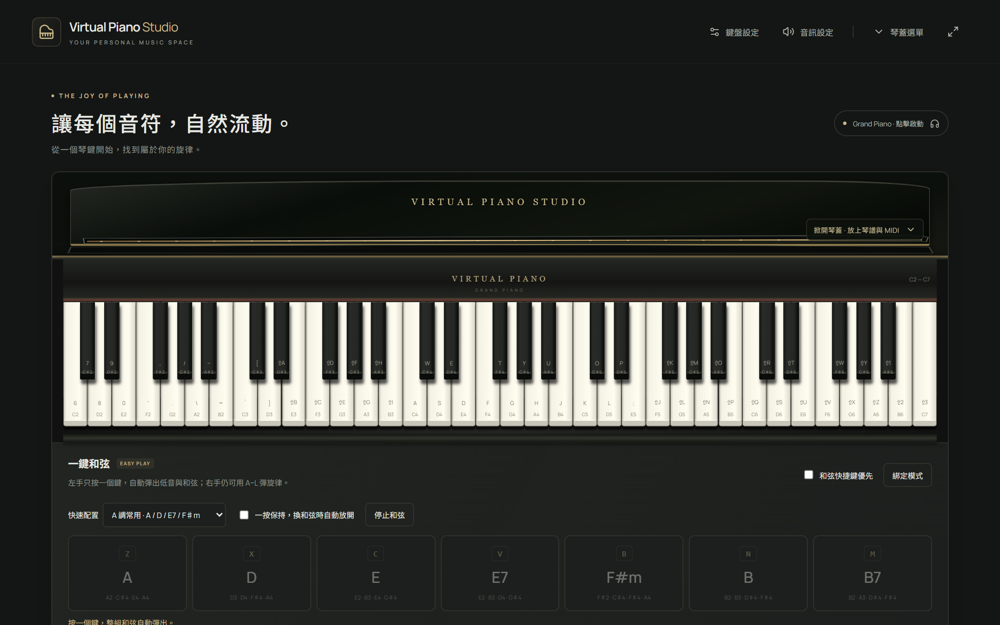
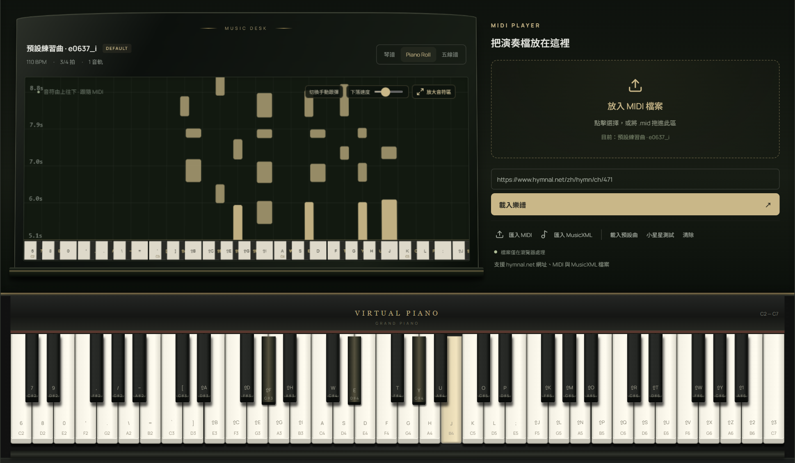
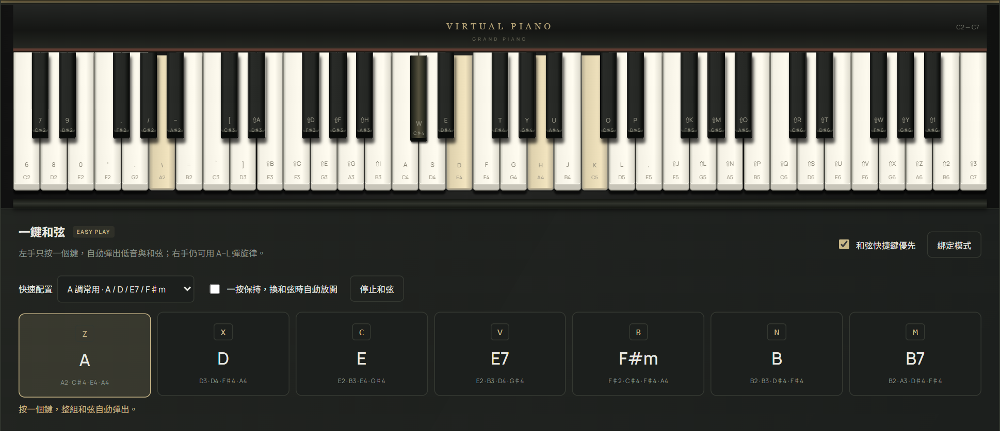
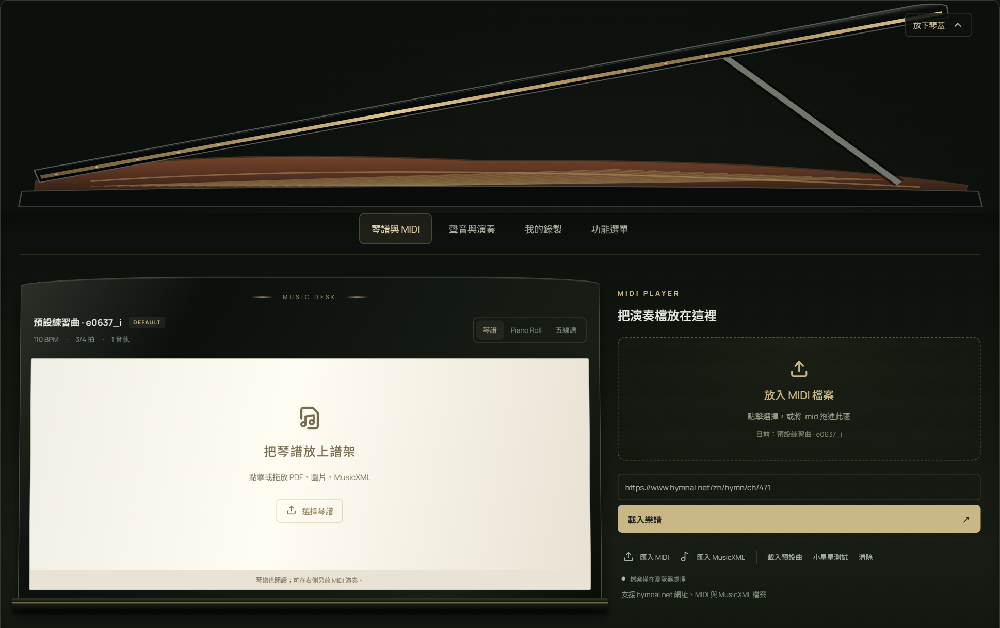
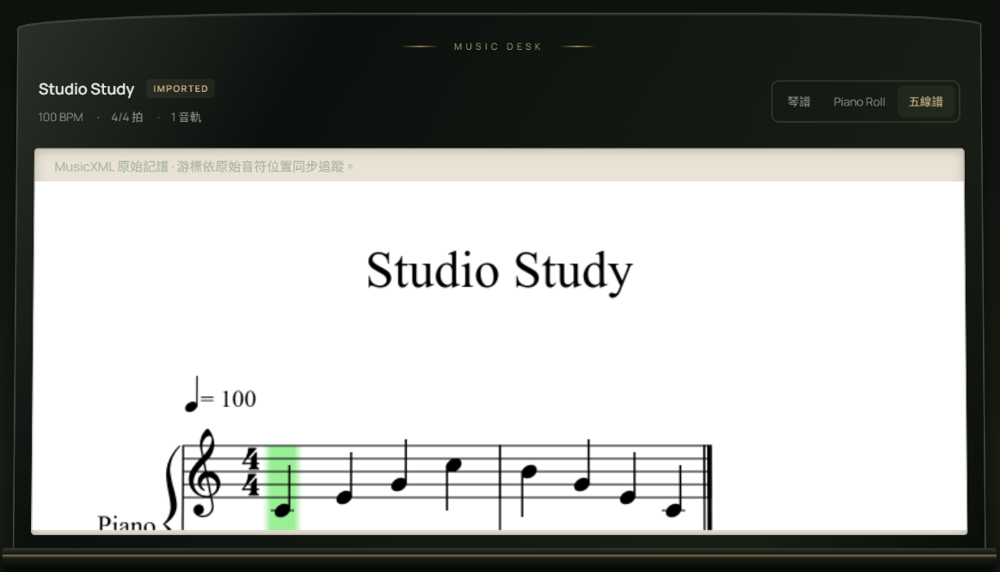
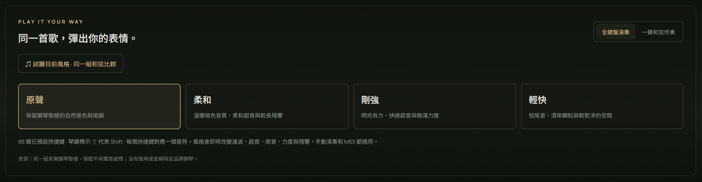
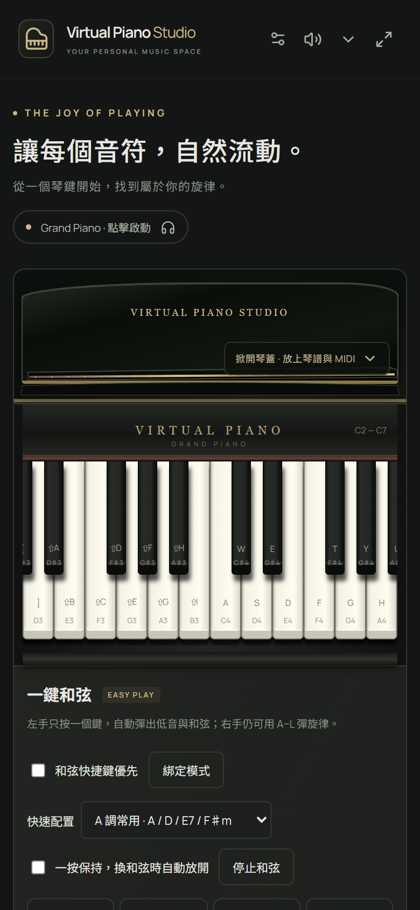
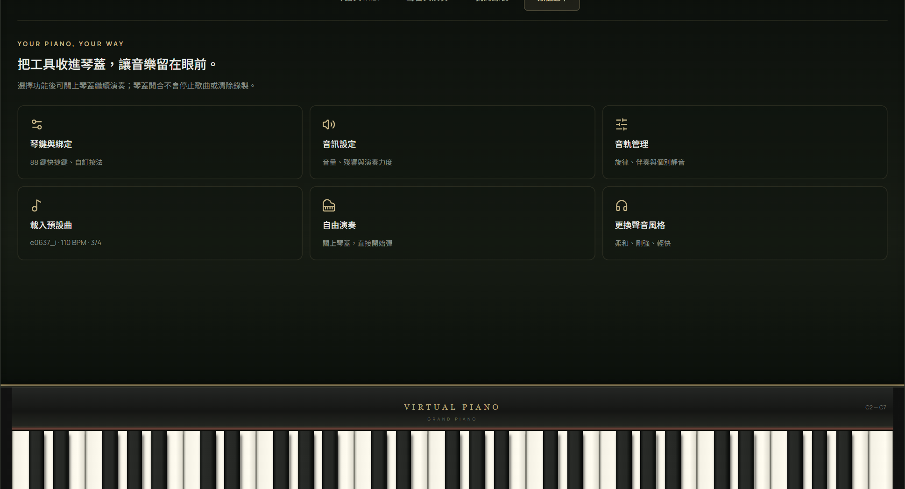

<div align="center">

# 🎹 Virtual Piano Studio

### 把你的電腦鍵盤，變成一台三角鋼琴。

**不用買琴、不用註冊、不用安裝。打開網頁，按下 `A`，就開始彈。**

真實鋼琴取樣 · 88 鍵全快捷鍵 · 一鍵彈出整組和弦 · MIDI／五線譜跟彈 · 錄下你的演奏匯出 MIDI

<br>


<br>

<!-- 部署後把下面網址換成你的 GitHub Pages 網址 -->
**[▶ 線上試玩](https://YOUR_NAME.github.io/virtual-piano-studio/)** · [30 秒上手](#-30-秒上手) · [鍵盤對照表](#-鍵盤對照表) · [自己架一台](#-自己架一台)

<br>



</div>

---

## 💡 為什麼做這個？

你一定想過：「**要是能隨手彈幾下就好了**。」

但真的鋼琴很貴、很佔空間；手機 App 滿滿是廣告、要訂閱；大部分網頁鋼琴則是一按就「嗶」一聲，彈兩下就不想再彈。

所以我做了一台**真的好聽、真的好彈、而且完全免費**的鋼琴，就放在瀏覽器裡：

- 🎼 **聲音是真鋼琴**：使用 Salamander Grand Piano 的真實取樣，不是合成器音色。
- ⌨️ **鍵盤就是琴鍵**：88 個鍵每一個都有快捷鍵，不用滑鼠也能彈完整首曲子。
- 🎸 **不會彈也能伴奏**：左手按一個鍵就是一整組和弦，右手彈旋律，三分鐘就能自彈自唱。
- 🔒 **你的音樂留在你的電腦**：沒有後端、沒有帳號、不上傳任何檔案。

---

## ✨ 亮點一覽

<table>
<tr>
<td width="50%" valign="top">

### 🎹 看著音符落下，跟著彈

匯入 MIDI，音符像瀑布一樣從上方落下，正在發聲的琴鍵即時亮起。可以調慢速度、轉調、A/B 段落循環，練到會為止。

</td>
<td width="50%" valign="top">



</td>
</tr>
<tr>
<td width="50%" valign="top">



</td>
<td width="50%" valign="top">

### 🎸 一鍵和弦，零基礎也能伴奏

按 `Z` 就是 A 和弦，按 `X` 就是 D 和弦，低音和和弦音一次到位。開啟「一按保持」後，按一下就持續發聲，換和弦時自動放開。

</td>
</tr>
<tr>
<td width="50%" valign="top">

### 🪵 掀開琴蓋，所有工具都在裡面

點一下琴蓋，三角鋼琴的上蓋會斜斜掀起，裡面有譜架和 MIDI 放置區。把 PDF、圖片或 MusicXML 樂譜放上譜架，邊看邊彈。

</td>
<td width="50%" valign="top">



</td>
</tr>
<tr>
<td width="50%" valign="top">



</td>
<td width="50%" valign="top">

### 🎼 五線譜也會跟著你走

匯入 MusicXML，就能看到原汁原味的五線譜，綠色游標隨著播放一格一格前進。

</td>
</tr>
</table>

### 🎨 同一首歌，彈出四種表情



**原聲**保留鋼琴原本的音色；**柔和**溫暖、適合夜深人靜；**剛強**明亮有力；**輕快**顆粒清楚，適合輕快的曲子。每次切換都會即時改變濾波、起音、尾音、力度與殘響。

### 📱 手機也能彈



支援多點觸控，可以同時按好幾個鍵、手指滑過琴鍵做出滑奏。窄螢幕可以用鍵盤下方的滑桿切換音域。

建議把手機**橫放**，琴鍵會比較好按。

<br clear="right">

---

## 🚀 30 秒上手

> 第一次打開時，請先**點任意一個琴鍵**或右上角的「**Grand Piano**」。瀏覽器規定網頁不能自己發出聲音，點一下才會啟動音訊並下載鋼琴取樣（只需要下載一次）。

### ① 自由彈奏

直接按鍵盤：

```
 W E   T Y U   O P        ← 黑鍵
A S D F G H J K L ;       ← 白鍵（中央 C 從 A 開始）
```

按住 **`Space`** 是延音踏板，**`Page Up` / `Page Down`** 可以切換八度。

### ② 一鍵和弦伴奏

1. 往下捲到「**一鍵和弦**」，勾選「**和弦快捷鍵優先**」。
2. 左手按 `Z` `X` `C` `V`，右手照常用 `A`～`L` 彈旋律。
3. 想按一下就持續發聲，勾選「**一按保持**」。

### ③ 跟著 MIDI 練習

1. 點琴蓋「**掀開琴蓋 · 放上琴譜與 MIDI**」。
2. 把 `.mid` 檔拖到「**放入 MIDI 檔案**」，或點「匯入 MIDI」選檔。
3. 譜架切到「**Piano Roll**」，按下方的 ▶ 播放。
4. 想自己彈，就切到「**練習模式**」：
   - **等待正確音符**：同時按對當下所有音，才會往下走。
   - **節奏練習**：主旋律會靜音，系統依實際按鍵計算正確、錯誤、遺漏與平均時間誤差。

### ④ 錄下你的演奏

琴蓋 →「**我的錄製**」→「**開始新錄製**」，彈完之後可以「**載入回放**」或「**匯出 MIDI**」，帶到 GarageBand、Logic、FL Studio 繼續編曲。

---

## 🎛 鍵盤對照表

### 單音（中央區）

| 鍵 | `A` | `W` | `S` | `E` | `D` | `F` | `T` | `G` | `Y` | `H` | `U` | `J` | `K` | `O` | `L` | `P` | `;` |
|---|---|---|---|---|---|---|---|---|---|---|---|---|---|---|---|---|---|
| 音 | C4 | C♯4 | D4 | D♯4 | E4 | F4 | F♯4 | G4 | G♯4 | A4 | A♯4 | B4 | C5 | C♯5 | D5 | D♯5 | E5 |

其餘音域使用數字、符號與 **Shift** 組合，琴鍵上的 `⇧` 代表要按 Shift。每個琴鍵上都印著自己的快捷鍵，看著按就對了。

### 一鍵和弦（預設 A 調）

| 鍵 | `Z` | `X` | `C` | `V` | `B` | `N` | `M` |
|---|---|---|---|---|---|---|---|
| 和弦 | A | D | E | E7 | F♯m | B | B7 |

快速配置裡也有 **C 調常用**組合。「綁定模式」可以換和弦種類、改綁按鍵，或新增和弦。

### 控制鍵

| 鍵 | 功能 |
|---|---|
| `Space` | 延音踏板（可改成右 Ctrl） |
| `Page Up` / `Page Down` | 升／降八度 |
| `Shift` + 鍵 | 彈奏外側音域 |

> 在輸入框裡打字、或按 Ctrl／Cmd 快捷鍵時不會誤觸發琴聲。

---

## 🧰 完整功能



| 類別 | 功能 |
|---|---|
| **演奏** | 61 鍵（C2–C7）或 88 鍵（A0–C8）、滑鼠、實體鍵盤、多點觸控、滑奏、延音踏板 |
| **按鍵設定** | 每個音都能重新綁定，重複按鍵會警告；可存多組配置、匯出／匯入 JSON |
| **音色** | 真實三角鋼琴取樣、四種聲音風格、音量、殘響、觸鍵力度、轉調 |
| **播放器** | 播放、暫停、Seek、0.25×–2× 變速、±12 半音轉調、節拍器、A/B 循環、個別音軌開關 |
| **檔案** | MIDI（多音軌、變速、變拍、CC64 踏板）、MusicXML、PDF／圖片琴譜，拖放即可，上限 20MB |
| **視覺** | Canvas Piano Roll、OpenSheetMusicDisplay 五線譜與同步游標、全螢幕 |
| **練習** | 等待模式、節奏模式（容許誤差 ±100／200／300ms）、完成率統計 |
| **錄製** | 錄下手動單音、和弦與延音，回放或匯出標準 MIDI |
| **隱私** | 純前端，檔案只在瀏覽器裡解析，設定存在 localStorage |

想看每個功能的技術細節，請見 [docs/FEATURES.md](docs/FEATURES.md)。

---

## 🛠 自己架一台

需要 **Node.js 20.19+** 或 **22.12+**。

```bash
git clone https://github.com/YOUR_NAME/virtual-piano-studio.git
```

```bash
cd virtual-piano-studio
```

```bash
npm install
```

```bash
npm run dev
```

打開終端機顯示的 `http://localhost:5173` 就能彈了。

| 指令 | 用途 |
|---|---|
| `npm run dev` | 開發伺服器 |
| `npm test` | 執行 49 項自動化測試 |
| `npm run build` | 建置靜態網站到 `dist/` |
| `npm run preview` | 預覽建置結果 |

### 一鍵部署到 GitHub Pages

1. Fork 或推送這個專案到你的 GitHub。
2. Repository → **Settings → Pages → Source** 選擇 **GitHub Actions**。
3. 推送到 `main`，[`.github/workflows/deploy.yml`](.github/workflows/deploy.yml) 會自動測試、建置並部署。

Vite 使用相對路徑 `base: './'`，放在任何子路徑都能正常運作。

---

## 🧠 技術架構

```
src/
├── audio/
│   ├── PianoEngine.ts        取樣載入、按鍵／延音分離、輸出 limiter
│   ├── PlaybackScheduler.ts  Tone Transport look-ahead 排程（畫面才用 rAF）
│   ├── LiveRecorder.ts       錄製演奏事件 → MIDI
│   └── styles.ts             四種聲音風格參數
├── music/                    資料模型、MIDI／MusicXML 解析、鍵位、和弦
├── components/               琴鍵、琴蓋、和弦面板、譜架、Piano Roll
├── store.ts                  Zustand 偏好設定（localStorage）
└── App.tsx                   主介面與互動
```

**幾個用心的地方：**

- 🎯 **音訊時鐘排程**：播放用 Web Audio 的 look-ahead 排程，不是 `setTimeout`，所以快速段落也不會亂掉；`requestAnimationFrame` 只負責畫面。
- 🦶 **踏板邏輯和真鋼琴一樣**：放開琴鍵後，若踏板還踩著，聲音會繼續延續；滑鼠、鍵盤與 MIDI 同時按同一個音也不會互相打架。
- 🧪 **49 項測試**：涵蓋 MIDI 編解碼、MusicXML 解析、排程、踏板、鍵位衝突、錄製與琴蓋元件。

---

## ❓ 常見問題

<details>
<summary><b>為什麼一開始沒有聲音？</b></summary>

瀏覽器規定網頁必須等使用者互動後才能播放聲音。點任意一個琴鍵或「Grand Piano」按鈕，就會開始下載取樣，看到「已就緒」就能彈了。
</details>

<details>
<summary><b>電腦鍵盤能彈出輕重嗎？</b></summary>

不行。電腦鍵盤沒有力度感測器，所以這裡使用固定力度（可在音訊設定調整），不會假裝能偵測輕重。聲音風格可以改變整體表情。
</details>

<details>
<summary><b>可以直接貼 hymnal.net 的網址匯入嗎？</b></summary>

可以試試看，但瀏覽器的跨網域限制（CORS）常會擋下讀取。被擋時頁面會提示並附上原站連結，請自行合法下載 MIDI 後再拖進來。
</details>

<details>
<summary><b>支援 .mxl 壓縮檔或反覆記號嗎？</b></summary>

目前支援未壓縮的 partwise MusicXML。遇到反覆、裝飾音等完整演奏語意時，會改為建議使用 MIDI 播放。
</details>

<details>
<summary><b>可以離線使用嗎？</b></summary>

鋼琴取樣第一次會從 Tone.js 的 CDN 下載，之後依瀏覽器快取使用。目前不是離線 PWA。
</details>

<details>
<summary><b>手機上延遲大嗎？</b></summary>

依裝置與瀏覽器而定，iOS Safari 和 Android Chrome 的實機延遲仍在驗證中。藍牙耳機會明顯增加延遲，建議使用有線耳機或手機喇叭。
</details>

---

## 🗺 接下來想做的

- [ ] Web MIDI：接上實體 MIDI 鍵盤，支援真正的力度
- [ ] 離線 PWA
- [ ] 更多音色（電鋼琴、管風琴）
- [ ] 大型 MIDI 的 Worker 解析

有想法？歡迎開 [Issue](../../issues) 或送 PR！

---

## 🙏 致謝與授權

- 鋼琴音源：**Salamander Grand Piano v3** — Alexander Holm，[CC BY 3.0](https://creativecommons.org/licenses/by/3.0/)（[原始專案](https://github.com/sfzinstruments/SalamanderGrandPiano)，網頁使用 [Tone.js 提供的 MP3 版本](https://tonejs.github.io/audio/salamander/)）。音源作者不為本專案背書。
- 字型：Manrope、Noto Sans TC（SIL OFL）。
- 開源套件：[Tone.js](https://tonejs.github.io/)、[@tonejs/midi](https://github.com/Tonejs/Midi)、[OpenSheetMusicDisplay](https://opensheetmusicdisplay.org/)、[Zustand](https://github.com/pmndrs/zustand)、[Lucide](https://lucide.dev/)。

<div align="center">

<br>

### 如果這台鋼琴讓你彈出了一點快樂，

### 請幫它按一顆 ⭐ Star，讓更多人找到它。

<br>

為每一位熱愛音樂的人而作。🎹

</div>
